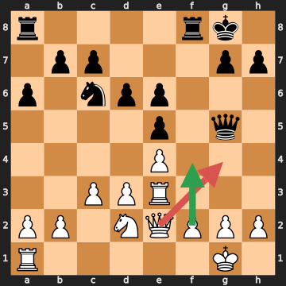
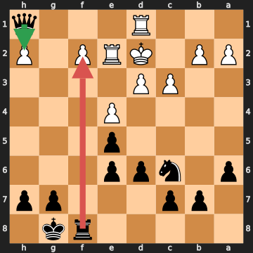

# Анализ шахматных партий

## Партия 1: Amateur White — Amateur Black (Club blitz (synthetic), 2026.09.14)

- Результат: **0-1**
- Движок: `fake` (глубина 14)
- Ходов: 48

### Сводка

| Игрок | Цвет | Точность | ACPL | лучший ход | отличный ход | хороший ход | неточность | ошибка | грубая ошибка (зевок) |
|---|---|---|---|---|---|---|---|---|---|
| Amateur White | белые | 89.7% | 32.7 | 23 | 0 | 0 | 0 | 0 | 1 |
| Amateur Black | чёрные | 98.7% | 16.3 | 23 | 0 | 0 | 0 | 0 | 1 |

### Критические моменты

#### 17. Qg4?? — грубая ошибка (зевок)

- FEN: `r4rk1/1pp3pp/p1npp3/4p1q1/4P3/2PPR3/PP1NQPPP/R5K1 w - - 2 17`
- Сыграно: **Qg4**, Лучше: **f4**
- Линия: f4 exf4
- Оценка (для ходившего): -1.12 → -8.96 (Потеря: 784 cp)
- Мотивы: ферзь на g4 остаётся под боем без достаточной защиты; соперник связывает фигуру ходом Qxg4 (пешка на g2)
- [Открыть на lichess](https://lichess.org/analysis/standard/r4rk1/1pp3pp/p1npp3/4p1q1/4P3/2PPR3/PP1NQPPP/R5K1_w_-_-_2_17)

> 17. Qg4 — грубая ошибка (зевок): оценка изменилась с -1.12 до -8.96 (потеря 784 сп). Ферзь на g4 остаётся под боем без достаточной защиты; соперник связывает фигуру ходом Qxg4 (пешка на g2). Сильнее было f4 (линия: f4 exf4).

#### 24... Rxf2?? — грубая ошибка (зевок)

- FEN: `5rk1/1pp3pp/p1npp3/4p3/4P3/2PP4/PP1KRP1P/3R3q b - - 5 24`
- Сыграно: **Rxf2**, Лучше: **Qxh2**
- Линия: Qxh2 a4
- Оценка (для ходившего): +9.42 → +5.50 (Потеря: 392 cp)
- Мотивы: ферзь на h1 остаётся под боем без достаточной защиты; ладья на f2 остаётся под боем без достаточной защиты
- [Открыть на lichess](https://lichess.org/analysis/standard/5rk1/1pp3pp/p1npp3/4p3/4P3/2PP4/PP1KRP1P/3R3q_b_-_-_5_24)

> 24... Rxf2 — грубая ошибка (зевок): оценка изменилась с +9.42 до +5.50 (потеря 392 сп). Ферзь на h1 остаётся под боем без достаточной защиты; ладья на f2 остаётся под боем без достаточной защиты. Сильнее было Qxh2 (линия: Qxh2 a4).

