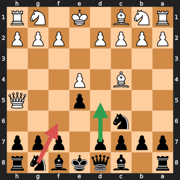
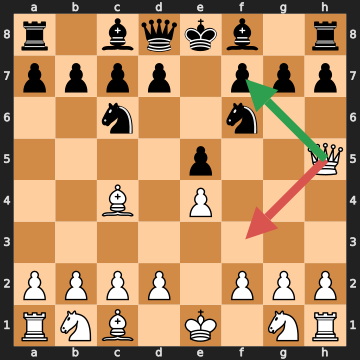
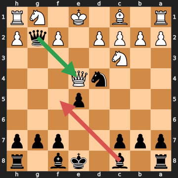
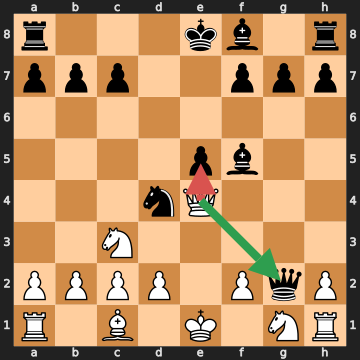
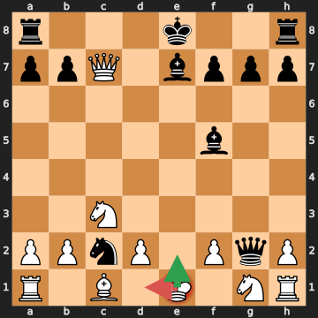
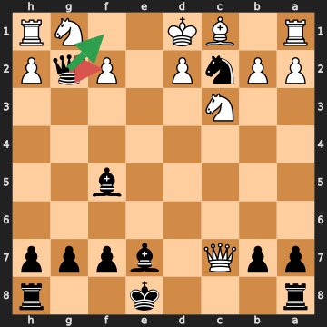
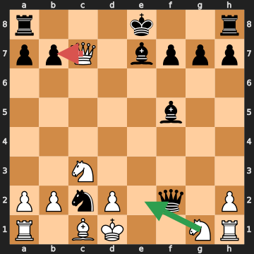

# Анализ шахматных партий

## Партия 1: Hasty Hero — Patient Pawn (Online rapid (synthetic), 2026.09.20)

- Результат: **0-1**
- Движок: `fake` (глубина 14)
- Ходов: 26

### Сводка

| Игрок | Цвет | Точность | ACPL | лучший ход | отличный ход | хороший ход | неточность | ошибка | грубая ошибка (зевок) |
|---|---|---|---|---|---|---|---|---|---|
| Hasty Hero | белые | 82.0% | 146.1 | 9 | 0 | 0 | 0 | 1 | 3 |
| Patient Pawn | чёрные | 61.5% | 159.1 | 10 | 0 | 0 | 0 | 1 | 2 |

### Критические моменты

#### 3... Nf6?? — грубая ошибка (зевок)

- FEN: `r1bqkbnr/pppp1ppp/2n5/4p2Q/2B1P3/8/PPPP1PPP/RNB1K1NR b KQkq - 3 3`
- Сыграно: **Nf6**, Лучше: **d5**
- Линия: d5 exd5
- Оценка (для ходившего): -1.08 → #-1 (Потеря: 892 cp)
- Мотивы: сопернику разрешён мат в 1 (Qxf7#)
- [Открыть на lichess](https://lichess.org/analysis/standard/r1bqkbnr/pppp1ppp/2n5/4p2Q/2B1P3/8/PPPP1PPP/RNB1K1NR_b_KQkq_-_3_3)

> 3... Nf6 — грубая ошибка (зевок): оценка изменилась с -1.08 до #-1 (потеря 892 сп). Сопернику разрешён мат в 1 (Qxf7#). Сильнее было d5 (линия: d5 exd5).

#### 4. Qf3? — ошибка

- FEN: `r1bqkb1r/pppp1ppp/2n2n2/4p2Q/2B1P3/8/PPPP1PPP/RNB1K1NR w KQkq - 4 4`
- Сыграно: **Qf3**, Лучше: **Qxf7#**
- Линия: Qxf7#
- Оценка (для ходившего): #1 → +3.14 (Потеря: 686 cp)
- Мотивы: упущен мат в 1 (Qxf7#)
- [Открыть на lichess](https://lichess.org/analysis/standard/r1bqkb1r/pppp1ppp/2n2n2/4p2Q/2B1P3/8/PPPP1PPP/RNB1K1NR_w_KQkq_-_4_4)

> 4. Qf3 — ошибка: оценка изменилась с #1 до +3.14 (потеря 686 сп). Упущен мат в 1 (Qxf7#). Сильнее было Qxf7# (линия: Qxf7#).

#### 9... Bf5?? — грубая ошибка (зевок)

- FEN: `r1b1kb1r/ppp2ppp/8/4p3/3nQ3/2N5/PPPP1PqP/R1B1K1NR b KQkq - 1 9`
- Сыграно: **Bf5**, Лучше: **Qxe4+**
- Линия: Qxe4+ Nxe4
- Оценка (для ходившего): +1.25 → -6.62 (Потеря: 787 cp)
- Мотивы: ферзь на g2 остаётся под боем без достаточной защиты; упущено взятие: ферзь на e4 (Qxe4+)
- [Открыть на lichess](https://lichess.org/analysis/standard/r1b1kb1r/ppp2ppp/8/4p3/3nQ3/2N5/PPPP1PqP/R1B1K1NR_b_KQkq_-_1_9)

> 9... Bf5 — грубая ошибка (зевок): оценка изменилась с +1.25 до -6.62 (потеря 787 сп). Ферзь на g2 остаётся под боем без достаточной защиты; упущено взятие: ферзь на e4 (Qxe4+). Сильнее было Qxe4+ (линия: Qxe4+ Nxe4).

#### 10. Qxe5+?? — грубая ошибка (зевок)

- FEN: `r3kb1r/ppp2ppp/8/4pb2/3nQ3/2N5/PPPP1PqP/R1B1K1NR w KQkq - 2 10`
- Сыграно: **Qxe5+**, Лучше: **Qxg2**
- Линия: Qxg2 Bxc2
- Оценка (для ходившего): +6.62 → +3.11 (Потеря: 351 cp)
- Мотивы: ладья на h1 остаётся под боем без достаточной защиты; упущено взятие: ферзь на g2 (Qxg2)
- [Открыть на lichess](https://lichess.org/analysis/standard/r3kb1r/ppp2ppp/8/4pb2/3nQ3/2N5/PPPP1PqP/R1B1K1NR_w_KQkq_-_2_10)

> 10. Qxe5+ — грубая ошибка (зевок): оценка изменилась с +6.62 до +3.11 (потеря 351 сп). Ладья на h1 остаётся под боем без достаточной защиты; упущено взятие: ферзь на g2 (Qxg2). Сильнее было Qxg2 (линия: Qxg2 Bxc2).

#### 12. Kd1?? — грубая ошибка (зевок)

- FEN: `r3k2r/ppQ1bppp/8/5b2/8/2N5/PPnP1PqP/R1B1K1NR w KQkq - 0 12`
- Сыграно: **Kd1**, Лучше: **Ke2**
- Линия: Ke2 Qxh1
- Оценка (для ходившего): -5.27 → #-1 (Потеря: 473 cp)
- Мотивы: сопернику разрешён мат в 1 (Qf1#); ладья на a1 остаётся под боем без достаточной защиты; ладья на h1 остаётся под боем без достаточной защиты
- [Открыть на lichess](https://lichess.org/analysis/standard/r3k2r/ppQ1bppp/8/5b2/8/2N5/PPnP1PqP/R1B1K1NR_w_KQkq_-_0_12)

> 12. Kd1 — грубая ошибка (зевок): оценка изменилась с -5.27 до #-1 (потеря 473 сп). Сопернику разрешён мат в 1 (Qf1#); ладья на a1 остаётся под боем без достаточной защиты; ладья на h1 остаётся под боем без достаточной защиты. Сильнее было Ke2 (линия: Ke2 Qxh1).

#### 12... Qxf2? — ошибка

- FEN: `r3k2r/ppQ1bppp/8/5b2/8/2N5/PPnP1PqP/R1BK2NR b kq - 1 12`
- Сыграно: **Qxf2**, Лучше: **Qf1#**
- Линия: Qf1#
- Оценка (для ходившего): #1 → +6.11 (Потеря: 389 cp)
- Мотивы: упущен мат в 1 (Qf1#)
- [Открыть на lichess](https://lichess.org/analysis/standard/r3k2r/ppQ1bppp/8/5b2/8/2N5/PPnP1PqP/R1BK2NR_b_kq_-_1_12)

> 12... Qxf2 — ошибка: оценка изменилась с #1 до +6.11 (потеря 389 сп). Упущен мат в 1 (Qf1#). Сильнее было Qf1# (линия: Qf1#).

#### 13. Qxb7?? — грубая ошибка (зевок)

- FEN: `r3k2r/ppQ1bppp/8/5b2/8/2N5/PPnP1q1P/R1BK2NR w kq - 0 13`
- Сыграно: **Qxb7**, Лучше: **Nge2**
- Линия: Nge2 Nxa1
- Оценка (для ходившего): -6.11 → #-1 (Потеря: 389 cp)
- Мотивы: сопернику разрешён мат в 1 (Qe1#); ладья на a1 остаётся под боем без достаточной защиты
- [Открыть на lichess](https://lichess.org/analysis/standard/r3k2r/ppQ1bppp/8/5b2/8/2N5/PPnP1q1P/R1BK2NR_w_kq_-_0_13)

> 13. Qxb7 — грубая ошибка (зевок): оценка изменилась с -6.11 до #-1 (потеря 389 сп). Сопернику разрешён мат в 1 (Qe1#); ладья на a1 остаётся под боем без достаточной защиты. Сильнее было Nge2 (линия: Nge2 Nxa1).

