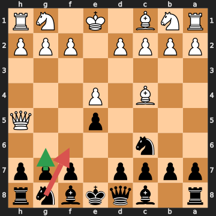
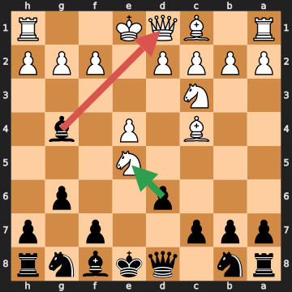

# Анализ шахматных партий

## Партия 1: Novice A — Novice B (Demo miniature (Scholar's mate), 2026.10.01)

- Результат: **1-0**
- Движок: `fake` (глубина 14)
- Ходов: 7

### Сводка

| Игрок | Цвет | Точность | ACPL | лучший ход | отличный ход | хороший ход | неточность | ошибка | грубая ошибка (зевок) |
|---|---|---|---|---|---|---|---|---|---|
| Novice A | белые | 100.0% | 0.0 | 4 | 0 | 0 | 0 | 0 | 0 |
| Novice B | чёрные | 52.4% | 301.0 | 2 | 0 | 0 | 0 | 0 | 1 |

### Критические моменты

#### 3... Nf6?? — грубая ошибка (зевок)

- FEN: `r1bqkbnr/pppp1ppp/2n5/4p2Q/2B1P3/8/PPPP1PPP/RNB1K1NR b KQkq - 3 3`
- Сыграно: **Nf6**, Лучше: **g6**
- Линия: g6 Qf3 Nh6 Qxf7+
- Оценка (для ходившего): -0.97 → #-1 (Потеря: 903 cp)
- Мотивы: сопернику разрешён мат в 1 (Qxf7#)
- [Открыть на lichess](https://lichess.org/analysis/standard/r1bqkbnr/pppp1ppp/2n5/4p2Q/2B1P3/8/PPPP1PPP/RNB1K1NR_b_KQkq_-_3_3)

> 3... Nf6 — грубая ошибка (зевок): оценка изменилась с -0.97 до #-1 (потеря 903 сп). Сопернику разрешён мат в 1 (Qxf7#). Сильнее было g6 (линия: g6 Qf3 Nh6 Qxf7+).

## Партия 2: Legal de Kermeur — Saint Brie (Paris (Legal's mate), 1750.??.??)

- Результат: **1-0**
- Движок: `fake` (глубина 14)
- Ходов: 13

### Сводка

| Игрок | Цвет | Точность | ACPL | лучший ход | отличный ход | хороший ход | неточность | ошибка | грубая ошибка (зевок) |
|---|---|---|---|---|---|---|---|---|---|
| Legal de Kermeur | белые | 100.0% | 0.0 | 7 | 0 | 0 | 0 | 0 | 0 |
| Saint Brie | чёрные | 75.0% | 128.3 | 5 | 0 | 0 | 0 | 0 | 1 |

### Критические моменты

#### 5... Bxd1?? — грубая ошибка (зевок)

- FEN: `rn1qkbnr/ppp2p1p/3p2p1/4N3/2B1P1b1/2N5/PPPP1PPP/R1BQK2R b KQkq - 0 5`
- Сыграно: **Bxd1**, Лучше: **dxe5**
- Линия: dxe5 Qxg4 Nc6 Qxg6
- Оценка (для ходившего): -2.30 → #-2 (Потеря: 770 cp)
- Мотивы: сопернику разрешён мат в 2 (Bxf7+); слон на d1 остаётся под боем без достаточной защиты; упущено взятие: конь на e5 (dxe5)
- [Открыть на lichess](https://lichess.org/analysis/standard/rn1qkbnr/ppp2p1p/3p2p1/4N3/2B1P1b1/2N5/PPPP1PPP/R1BQK2R_b_KQkq_-_0_5)

> 5... Bxd1 — грубая ошибка (зевок): оценка изменилась с -2.30 до #-2 (потеря 770 сп). Сопернику разрешён мат в 2 (Bxf7+); слон на d1 остаётся под боем без достаточной защиты; упущено взятие: конь на e5 (dxe5). Сильнее было dxe5 (линия: dxe5 Qxg4 Nc6 Qxg6).

